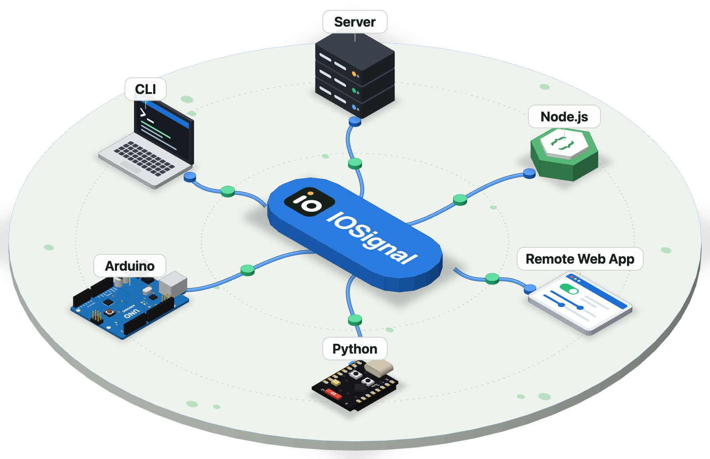

# Arduino IOSignal Client Library

[한국어](README.md) | **English**

The Arduino IOSignal library provides a client that connects Arduino boards to an IOSignal server, with examples for each board. Besides the channel examples, it holds the device, controller and camera examples that web apps find and control (formerly in [remocon-arduino](https://github.com/remocons/remocon-arduino)).

<p align="center">
  
</p>

## IOSignal

IOSignal supports real-time communication between web browsers, Node.js and Arduino, with authentication and encrypted communication. The signaling protocol is built into the server, so no server programming is required. Arduino connects to the server over CongSocket, a TCP transport (public server `io.iosignal.net:55488`).

## Versions

From **9.0.0**, this library uses the same version number as the public [iosignal](https://github.com/remocons/iosignal) package. iosignal-cli, the remocon CLI and [remocon-arduino](https://github.com/remocons/remocon-arduino) use the same number too. Packages with the same number are meant to be used together. See [Changes by version](#changes-by-version) below.

## Installation

1. In the Arduino IDE Library Manager, search for `IOSignal` and install it together with its dependencies **Boho** (1.1.0 or later), **Crypto** and **Bounce2**.
2. Until a new version reaches the Library Manager, download the ZIP from the [public repository](https://github.com/remocons/iosignal-arduino) and add it with **Sketch > Include Library > Add .ZIP Library**.
3. Open an example for your board from **File > Examples > IOSignal**. Some examples need more libraries (see [Examples](#examples)).

Supported boards: UNO with a W5100 Ethernet shield, UNO R4 WiFi, ESP8266 and ESP32 (including ESP32-C3). Each example targets specific boards; check the folder name.

## Basic usage

```cpp
#include <WiFi.h>
#include <IOSignal.h>

WiFiClient client;
IOSignal io;

void onReady() {
  Serial.println(io.cid);          // CID issued by the server
  io.subscribe("#homeButton");     // subscribe again in ready after every reconnection
}

void onMessage(char *tag, uint8_t type, uint8_t *payload, size_t size) {
  Serial.println(tag);
}

void setup() {
  Serial.begin(115200);
  // ... connect Wi-Fi ...
  io.setRxBuffer(200);             // call before begin()
  io.begin(&client, "io.iosignal.net", 55488);
  io.onReady(onReady);
  io.onMessage(onMessage);
  // io.auth("ID_KEY");            // when using authentication
}

void loop() {
  io.loop();
  // io.signal("#homeButton", "pressed");
}
```

- Call `loop()` on every iteration. After a disconnection it reconnects 3 seconds later.
- Sending: `signal(tag, ...)` for channel and CID tags, `signal2(target, topic, ...)` for a tag made by joining two strings (e.g. `signal2(cid, "@led", ...)` → `cid@led`), and `signal_e2e()` for end-to-end encryption.
- Diagnostics: `onError(callback)` receives error codes, and `setLog(callback)` receives human-readable notes.

## Board settings (ESP32, ESP8266, 9.13.0)

With `IOSignalConfig.h`, board settings change from a browser over USB without rebuilding the sketch. The page is [arduino.iosignal.net/wifi](https://arduino.iosignal.net/wifi/) (desktop Chrome or Edge, Korean). It uses the standard [Improv Wi-Fi Serial](https://www.improv-wifi.com/serial/) protocol plus IOSignal commands.

```cpp
#include <IOSignal.h>
#include <IOSignalConfig.h>

IOSignalConfig config;
IOSignalSetting target(config, "target", "Target CID", "the-cid", IOSignalSetting::CID); // optional sketch setting

void setup() {
  Serial.begin(115200);
  config.begin(Serial, "My Device", "WIFI_SSID", "WIFI_PASS"); // placeholders: use the Wi-Fi kept in the chip
  config.setServer("io.iosignal.net", 55488);                  // default server, changeable in the browser
  if (config.key()) io.auth(config.key());                     // device key set in the browser
  io.setLog([](const char* line) { Serial.println(line); });
  io.begin(&client, config.host(), config.port());
}

void loop() {
  config.loop();                     // browser requests, Wi-Fi reconnect
  if (config.connected()) io.loop();
}
```

- **Wi-Fi**: the chip keeps it for the next boot. Real values in the sketch win at every boot. A failed attempt goes back to the previous network.
- **Server (host:port) and device key (`id.key`)**: values set in the browser win over the sketch ones; clearing them brings the sketch values back. The key is never sent back.
- **Sketch settings** (`IOSignalSetting`): declare text, CID, integer (range), on/off or choice settings, optionally remote, secret or restart, and the page builds the fields. Code reads `value()`, `toInt()`, `toBool()` and applies changes in `onChange()`. Up to 8 settings, values up to 64 bytes.
- Values are kept in Preferences (ESP32) or LittleFS (ESP8266, a flash layout with a file system). ESP32 and ESP8266 only; on other boards the header is empty.
- A board that uses its TX pin for something else (ESP-01) starts with `begin(name, …)` without serial and calls `attachSerial()` only in a setup mode. A sketch that reads its own serial commands gets them through `onOtherInput()`.

## Examples

Parts, wiring, steps, browser firmware install and board settings for each example are on [arduino.iosignal.net](https://arduino.iosignal.net/) (Korean). Each example folder's `README.md` has the same content.

| Group | Examples | More libraries |
| --- | --- | --- |
| Channel send and receive | `esp_channel_txrx`, `uno_ethernet_channel_txrx`, `uno_r4_wifi_channel_txrx` | (UNO Ethernet: Ethernet) |
| Server features | `esp32c3_duplicate_login` | |
| iris board (ESP32-C3) | `iris-basic`, `iris-rgb`, `iris-group`, `iris-basic-controller`, `iris-button-controller` | FastLED |
| Relays and button controllers | `esp8266-relay4ch`, `esp01-relay-button`, `button-controller`, `esp01-button-controller`, `Remocon8266-button-controller` | (Remocon8266: U8g2) |
| Single devices | `esp32-cid-led`, `d1-mini-led-button`, `Remocon8266-basic`, `Remocon8266-tv`, `Remocon8266-scanner` | (Remocon8266: U8g2) |
| Cameras (ESP32-CAM) | `esp32cam`, `esp32cam-session` | |
| Group channels | `esp32-group-led`, `wifi-simple` | |
| UNO | `uno-ethernet-button`, `uno-ethernet-ir`, `uno-r4-wifi-heart` | Ethernet, (IR: IRremote) |

Web apps such as [remocon.kr](https://remocon.kr/) find the device examples and show each as a card. The rules for announcing the name (`$name`), screen (`$ui`) and state (`$state`) are in [Building a Remocon device](https://iosignal.net/en/docs/arduino/remocon-device). The examples share these helper headers:

- `IOSignalUi.h`: builds and reads `$name` (`name:category`) and `$ui` (`formatName()`, `formatNameSetting()`, `nameOf()`, `categoryOf()`, `isExtendedUi()`).
- `IOSignalBinding.h`, `IOSignalButtons.h`: what each controller button does comes from board settings (`b1` to `b7`); the controller subscribes to the target's state and toggles it (ESP32, ESP8266).

## RX buffer and large messages

- `setRxBuffer(size)` sets the largest frame the device can receive. Without it, `begin()` allocates **80 bytes**.
- The buffer size is sent to the server when connecting (`CID_REQ`), so call **`setRxBuffer()` before `begin()`**. An IOSignal 9.0 server does not send this device messages larger than that.
- A frame larger than the buffer (e.g. from an older server) is skipped without closing the connection. `onError(CongPacket::OVER_SIZE)` (254) and a `setLog` note are reported once.
- Outgoing sizes follow the server's quota. The server's `QUOTA` message is ignored.

## Authentication and duplicate logins

- Set credentials with `auth("ID.KEY")` or `auth(id, key)`, and the client logs in on every connection. On an authentication failure it clears the authentication state before calling `onError`.
- If another device logs in with the same ID and the server replaces this connection (`AUTH_CLEAR`), the client clears its credentials and **stops in the `IO_STOP` state**. It does not reconnect anonymously. Check the reason with `io.lastReason` and `setLog`; call `auth()` and `begin()` to start again.
- Example: [esp32c3_duplicate_login](examples/esp32c3_duplicate_login/esp32c3_duplicate_login.ino). For the server's duplicate login policy, see [server authentication](https://iosignal.net/en/docs/server/authentication#duplicate-login).

## Documentation and related packages

[IOSignal documentation — iosignal.net](https://iosignal.net/en/) covers installation, concepts, server configuration, browser and Arduino integration, and examples. New users can start with the [five-minute quickstart](https://iosignal.net/en/docs/start/quickstart/).

| Package | Role |
| --- | --- |
| [iosignal](https://github.com/remocons/iosignal) · [npm](https://www.npmjs.com/package/iosignal) | JavaScript communication library for Node.js servers, clients and browsers |
| [iosignal-cli](https://github.com/remocons/iosignal-cli) · [npm](https://www.npmjs.com/package/iosignal-cli) | Command-line tools for running IOSignal servers and clients and testing communication |
| [iosignal-arduino](https://github.com/remocons/iosignal-arduino) | This repository. Client library that connects Arduino devices to an IOSignal server |
| [boho](https://github.com/remocons/boho) · [npm](https://www.npmjs.com/package/boho) | Shared-key authentication and encryption library for JavaScript |
| [boho-arduino](https://github.com/remocons/boho-arduino) | Arduino implementation of Boho, the authentication and encryption dependency of this library |
| [remocon-arduino](https://github.com/remocons/remocon-arduino) | The former Remocon example library (9.22.0). Its examples moved to this repository |

For example guides and firmware install, use [arduino.iosignal.net](https://arduino.iosignal.net/). For device discovery and control, use the [Remocon web app](https://remocon.kr/). The [board workbench guide](https://iosignal.net/en/docs/examples/workbench/start) shows the connection steps.

## Boho dependency

IOSignal uses the external Arduino library **Boho 1.1.0 or later**. Boho is not bundled in `src/`. Install Boho and its dependency Crypto together with IOSignal. Keep a single Boho installation so an older copy is not used.

To develop locally before a new release reaches the Library Manager, install the updated `boho-arduino` library from a local folder or ZIP. The `depends` field follows the [Arduino library specification](https://docs.arduino.cc/arduino-cli/library-specification/).

## Changes by version

### Next version (not released)

- **The helper namespace is now `iosignal`.** Functions and constants of `IOSignalUi.h` and `IOSignalBinding.h` are written like `iosignal::formatNameSetting()`. The `remocon::` name of 9.23.0 and earlier stays as an alias of the same namespace, so those sketches still compile (they cannot also include `RemoconUi.h` from the old Remocon library).
- **The examples' default server is `io.iosignal.net`.** It was `io.remocon.kr`, the same broker, so nothing changes in behavior. A server saved in the board settings is still used.
- The examples' header comments say "device example" instead of "Remocon example".

### 9.23.0

- **Every Remocon example moved into this library.** The 22 examples of [remocon-arduino](https://github.com/remocons/remocon-arduino) 9.22.0 are under **File > Examples > IOSignal** with the same names. remocon-arduino stays as it is; new examples are added only here.
- **The helper headers were renamed.** `RemoconUi.h` → `IOSignalUi.h`, `RemoconBinding.h` → `IOSignalBinding.h`, `RemoconButtons.h` → `IOSignalButtons.h` (class `RemoconButtons` → `IOSignalButtons`). Functions and behavior are the same; a sketch that used the Remocon headers changes only its `#include` lines and the class name.
- Dependencies are unchanged (Boho, Crypto, Bounce2). FastLED, U8g2, IRremote and Ethernet are needed only by the examples that use them; install them separately.
- The example site is now [arduino.iosignal.net](https://arduino.iosignal.net/) (formerly test.iosignal.net and arduino.remocon.kr). The Wi-Fi hint in `IOSignalConfig.h` points to `https://arduino.iosignal.net/wifi/`.
- The public iosignal (npm) of the same time is 9.23.0. There is no IOSignal Arduino numbered 9.22.0.

### 9.21.0

- **A connection the server stopped answering on is dropped and opened again.** When nothing arrived for `pingPeriod` (50 s) the library sends a PING; with nothing from the server in the next 15 s it closes the connection and connects again. Before, a connection that only looked alive (a restarted router, a broken link) stayed stuck. `setLog()` gets `[IOSignal] no reply from <host>:<port>: reconnecting.` (left out on AVR boards such as the UNO).
- **`loop()` no longer stops while waiting to reconnect.** `io.loop()` used to `delay()` for 3 s, which also stopped the sketch's buttons, sensors and board settings. It now tries once every 3 s and returns at once. One attempt (`client.connect()`) still blocks until it ends. A sketch that relied on the 3 s pause while disconnected behaves differently.
- **Boho 1.1.0 or later is required.** The dependency is now `Boho (>=1.1.0)`. The login nonce no longer comes from `micros()`: ESP32 and ESP8266 use the chip's hardware random numbers, other boards a keyed hash of gathered timing. The server and the protocol are unchanged.
- **Three `setLog()` lines are shorter on the UNO (AVR).** The trailing hints ("Is it the IOSignal TCP port?" and the like) are left out to save flash. Other boards print the same text as before.
- The `esp32c3_duplicate_login` example counts a lost connection when the state changes to `IO_CLOSED`. Its output is the same.
- **The `esp01_channel_txrx` example was removed.** The ESP-01 examples are `esp01-relay-button` and `esp01-button-controller` (then in the Remocon library, in this library since 9.23.0).
- The public iosignal (npm) of the same time is 9.21.0. There is no IOSignal Arduino numbered 9.15 to 9.20.

### 9.14.2

- **Example folders were renamed.** Behaviour is unchanged.
  - `esp8266_channel_txrx` → `esp_channel_txrx` (for both ESP8266 and ESP32)
  - `uno_r4_wifi_channel_receiver_txrx` → `uno_r4_wifi_channel_txrx`
- **The `peer_ping_pong` example was removed.** Sending `@ping` to a CID and getting `@pong` back was a convention between applications, not a library feature, and it answered whatever CID a message named. Check direct messages with a channel example such as `esp_channel_txrx` and `io.signal("<cid>@topic", …)`. The CLIs (iosignal-cli, remocon, the remocon.kr web CLI) dropped `ping <cid>`; the server `ping` stays.
- The notes for earlier versions below keep the names used at the time.

### 9.14.1

- **Board settings can choose anonymous login (ESP32, ESP8266).** "익명으로 접속" (connect anonymously) on the [board settings page](https://test.iosignal.net/wifi/) makes the board connect without a key even when the sketch sets one (`setKey`). The board stores `-` as the key; clearing the stored key brings the sketch key back. Older firmware refuses this value.
- The `esp32c3_duplicate_login` example now defaults to `io.iosignal.net`. It needs an IOSignal server you run yourself and a device key registered on it; `ID_KEY` ("did.key") in the sketch is a placeholder.
- The Remocon example pages moved to [arduino.remocon.kr](https://arduino.remocon.kr/); [test.iosignal.net](https://test.iosignal.net/) now shows the IOSignal examples.

### 9.14.0

- **Less RAM on the UNO (AVR).** The `setLog()` texts and the redirect address format stay in flash (`PSTR`). In 9.13.0 the new texts were copied to RAM, and an UNO + Ethernet sketch could stop during boot. For `uno-ethernet-ir` (Remocon), global variables go from 1654 to 1226 bytes (free RAM 394 → 822 bytes). The log lines are unchanged.
- The 128-byte buffer for a log line is on the stack only while `setLog()` is set and a line is written.
- ESP32 board settings: the Wi-Fi scan works while the board keeps retrying a stored network that is out of reach (retrying pauses for the scan, then resumes).
- The `uno_ethernet_channel_txrx` example prints its serial texts with `F()` (RAM 1190 → 1126 bytes).
- The public iosignal (npm) package is 9.14.0 at this point.

### 9.13.0

- **Added board settings (ESP32, ESP8266).** `IOSignalConfig.h`, `IOSignalSettings.h`, `IOSignalImprov.h`. Wi-Fi, the server (host:port), the device key and sketch settings (`IOSignalSetting`) change from a browser over USB. See [Board settings](#board-settings-esp32-esp8266-9130) above.
- **Connection failures are reported.** With `setLog()`, the client prints a failed TCP connect, no server reply within 10 s (`SERVER_HELLO_TIMEOUT_MS`, e.g. a WebSocket or other wrong port) and a refused device key. With no reply it drops the connection and retries.
- The ESP examples (`esp8266_channel_txrx`, `esp01_channel_txrx`, `esp32c3_duplicate_login`, `peer_ping_pong`) use board settings and no longer block waiting for Wi-Fi.
- The `esp32cam` example was removed. It becomes a camera whose pictures show on a remocon.kr device card and moves to the Remocon library. The device key it contained stays in the public history: do not use it.
- This version changes the Arduino library only. The public iosignal (npm) package is 9.12.0 at this point.

### 9.12.0

- **The version number now matches the public iosignal 9.12.0 package.** The library code (`src`) is the same as 9.6.0.
- Overlapping examples were removed. The `_channel_sender` and `_channel_receiver` examples for `esp8266`, `uno_ethernet` and `uno_r4_wifi` are replaced by the `_channel_txrx` example of the same board, `esp32_channel_txrx` by `esp8266_channel_txrx` (which now builds for ESP8266 and ESP32), and `uno_ethernet_duplicate_login` by `esp32c3_duplicate_login`.
- Parts, wiring, steps and a browser panel for each example are on [test.iosignal.net](https://test.iosignal.net/) (Korean).

### 9.6.0

- **The version number now matches the public iosignal 9.6.0 package.**
- Added `unsubscribe(tag)`. It stops receiving a tag subscribed with `subscribe()`. Several tags can be given separated by commas, and an empty string (the default) removes every subscription.
- When a write does not send every byte (a stalled or broken socket), the client closes the connection and `loop()` reconnects. Previously the client could still look connected while every later write waited for the socket timeout. With `setLog()`, it prints `[IOSignal] send failed: reconnecting.`

### 9.0.0

- **The version number now matches the public iosignal package.** This release follows 7.0.0; there is no 8.x. It supports the iosignal 9.0 server features (RX size advertisement, `QUOTA`) and still connects to 8.x servers.
- Without an RX buffer, `begin()` allocates 80 bytes. Previously, not calling `setRxBuffer()` could leave an uninitialized buffer in use.
- `CID_REQ` carries the RX buffer size. A 9.0 server does not send larger messages; older servers ignore the extra bytes. Call `setRxBuffer()` before `begin()`.
- Frames larger than the buffer are skipped instead of closing the connection. Previously the client disconnected and reconnected, which looped forever when a subscribed channel held a large retained message. `onError(CongPacket::OVER_SIZE)` (254) now reports a skip, not a disconnection. A zero-length frame still closes the connection.
- The 9.0 server's `QUOTA` (0xC6) message is recognized and ignored. The `IOSignal::MsgType::QUOTA_LEVEL` (0xC3) constant was removed.
- The `esp32cam` example page uses the `iosignal@9.0.0` browser client.

### 7.0.0

- When the server sends `AUTH_CLEAR` (e.g. replaced by a new login with the same ID), the client clears its credentials and stops in the `IO_STOP` state. 6.x cleared the credentials and reconnected anonymously.
- `setLog(callback)` and `lastReason` report the reason.
- Added the duplicate login examples `uno_ethernet_duplicate_login` and `esp32c3_duplicate_login`.

### 6.0.0

- Uses Boho 1.0.0 or later for gradual clock correction through verified encrypted server packets and for send-time and counter reuse protection. The IOSignal packet format is unchanged. Reconnect when the server rejects an expired or reused authentication challenge or a packet outside the allowed time window. Plaintext PING/PONG carries no clock sample.
- On an authentication failure, the authentication state is cleared before the error callback runs. This includes malformed `AUTH_RES` responses.

## License

[MIT License](LICENSE)
