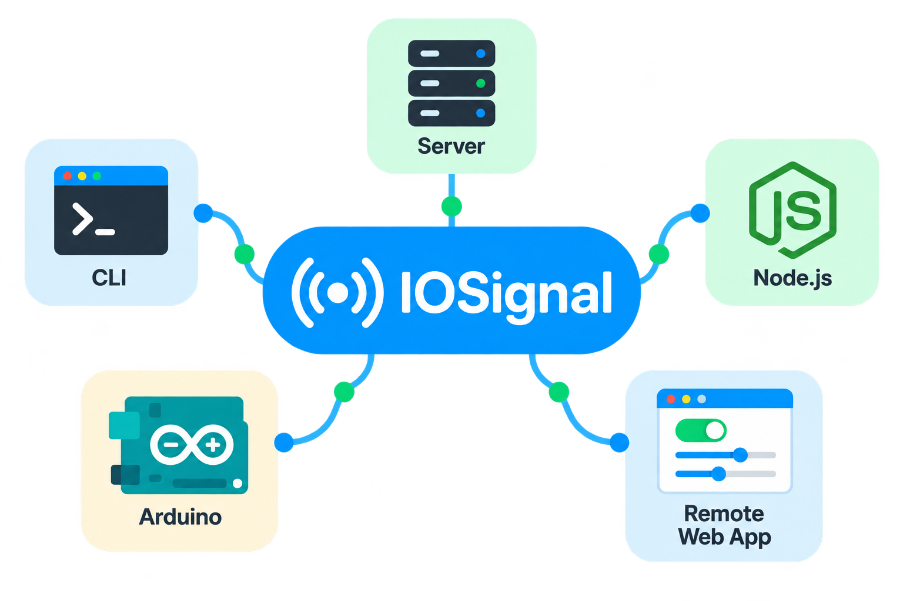

# Arduino IOSignal 클라이언트 라이브러리

**한국어** | [English](README.en.md)

Arduino IOSignal 라이브러리는 아두이노 클라이언트와 예제 소스를 제공합니다.

  

## IOSignal

IOSignal은 웹브라우저, Node.js, Arduino 간의 실시간 통신을 지원합니다. 보안 인증과 암호화 통신도 제공합니다. 서버에 시그널링 프로토콜이 내장되어 있어 별도의 서버 프로그래밍 없이 사용할 수 있습니다.

## 문서와 관련 패키지

[IOSignal 문서 사이트 — iosignal.net](https://iosignal.net/)에서 설치, 통신 개념, 서버 구성, 브라우저·Arduino 연동과 예제를 확인할 수 있습니다. 처음 시작한다면 [5분 빠른 시작](https://iosignal.net/docs/start/quickstart/)을 참고하세요.

| 패키지 | 역할 |
| --- | --- |
| [iosignal](https://github.com/remocons/iosignal) · [npm](https://www.npmjs.com/package/iosignal) | Node.js 서버·클라이언트 및 브라우저용 JavaScript 통신 라이브러리 |
| [iosignal-cli](https://github.com/remocons/iosignal-cli) · [npm](https://www.npmjs.com/package/iosignal-cli) | 터미널에서 IOSignal 서버·클라이언트를 실행하고 통신을 시험하는 도구 |
| [iosignal-arduino](https://github.com/remocons/iosignal-arduino) | 현재 저장소. Arduino 장치를 IOSignal 서버에 연결하는 클라이언트 라이브러리 |
| [boho](https://github.com/remocons/boho) · [npm](https://www.npmjs.com/package/boho) | JavaScript 환경의 공유 키 인증·암호화 라이브러리 |
| [boho-arduino](https://github.com/remocons/boho-arduino) | Arduino용 Boho 구현. 이 라이브러리의 인증·암호화 의존성 |
| [remocon-arduino](https://github.com/remocons/remocon-arduino) | IOSignal을 이용한 보드별 원격 제어 예제 모음 |

브라우저에서 직접 실습하려면 [IOSignal 통신 실습실](https://test.iosignal.net/)을, 장치 검색·제어 예제를 사용하려면 [Remocon 웹앱](https://remocon.kr/)을 이용하세요. [보드별 실습 안내](https://iosignal.net/docs/examples/workbench/start)에서 연결 순서를 확인할 수 있습니다.

## Boho 의존성

IOSignal은 외부 Arduino 라이브러리인 **Boho 1.0.0 이상**을 사용합니다. Boho 소스는 더 이상 `src/`에 포함되지 않습니다. IOSignal과 함께 Boho 및 Boho의 의존 라이브러리인 Crypto를 설치하세요. 오래된 사본이 사용되지 않도록 Boho는 하나만 설치해 두세요.

새 릴리스가 라이브러리 매니저에 등록되기 전에 로컬에서 개발하려면, 업데이트된 `boho-arduino` 라이브러리를 로컬 폴더 또는 ZIP으로 설치하세요.

`depends` 항목은 [Arduino 라이브러리 규격](https://docs.arduino.cc/arduino-cli/library-specification/)을 따릅니다.

## 6.0.0 버전의 시계 보정 의존성

이 버전은 검증된 서버 암호화 패킷을 통한 점진적 시계 보정과 송신 시간·카운터 재사용 방어를 위해 Boho 1.0.0 이상을 사용합니다. IOSignal 패킷 형식은 바뀌지 않습니다. 서버가 만료되거나 재사용된 인증 챌린지 또는 허용 시간 범위를 벗어난 패킷을 거부하면 재연결하세요. 평문 PING/PONG에는 시계 보정용 시간 샘플이 없습니다.

인증 실패 시에는 오류 콜백을 호출하기 전에 인증 상태를 해제합니다. 잘못된 형식의 `AUTH_RES` 응답도 여기에 포함됩니다.

## 장치 간 ping/pong 예제

ESP32(ESP32-C3 포함) 또는 ESP8266에서 [peer_ping_pong 예제](examples/peer_ping_pong/peer_ping_pong.ino)를 엽니다. Wi-Fi 자리표시자를 수정하고 컴파일·업로드한 뒤, 시리얼 모니터를 115200 baud로 열면 장치 CID와 수신 메시지 태그(`[RX]`)를 확인할 수 있습니다.

다른 장치의 ping에는 즉시 응답하며, 이어서 `[TX] @pong -> <sender-cid>`를 출력합니다. 모든 Arduino 예제는 `io.iosignal.net:55488`에 연결합니다. 웹 CLI에서 `open wss://io.iosignal.net/ws`를 실행한 뒤 `ping <arduino-cid>`를 입력하면, CLI에 `pong (<arduino-cid>)`가 출력됩니다.

이 예제는 `onMessage()`에서 직접 전달된 `@ping` TEXT 메시지만 처리합니다. 자신의 CID를 본문으로 담아 송신자 CID에 `@pong`을 즉시 보냅니다. CLI가 보내는 표준 형식인 단일 NUL 종단 TEXT CID 본문을 전제로 합니다.

CID 검증, 시리얼 명령 파서, 응답 대기 또는 시간 초과 처리는 포함하지 않습니다. 라이브러리 코어와 서버의 `io.ping()` / `io.pong()`은 변경되지 않습니다. 채널 구독도 필요하지 않습니다. 로컬 테스트에서는 같은 서버에서 WebSocket(CLI) 포트와 CongSocket(Arduino) 포트를 활성화하세요.
