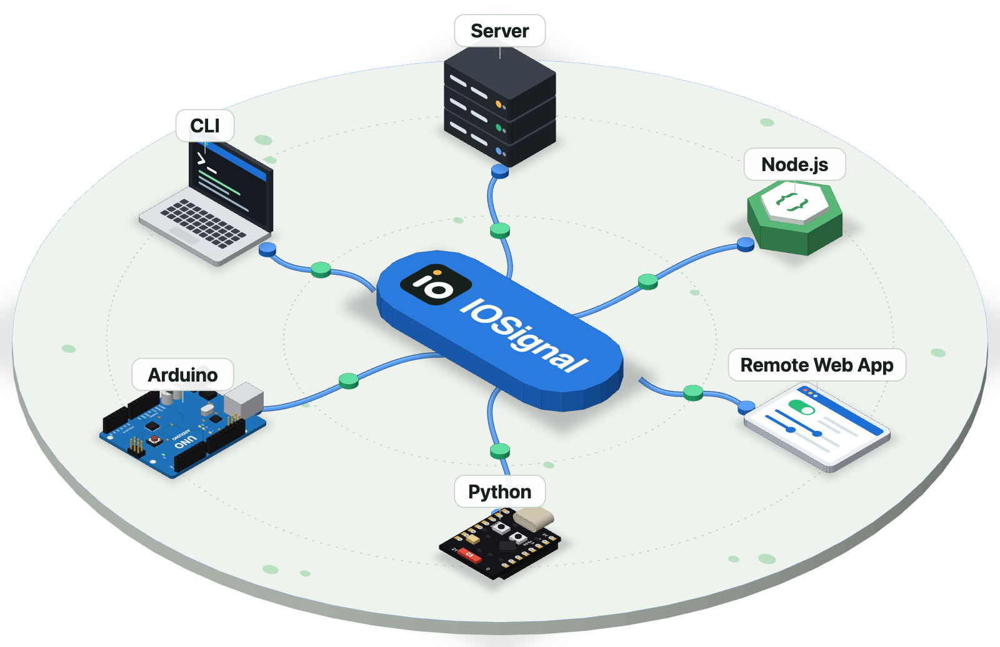

# Arduino IOSignal 클라이언트 라이브러리

**한국어** | [English](README.en.md)

Arduino IOSignal 라이브러리는 아두이노를 IOSignal 서버에 연결하는 클라이언트와 보드별 예제를 제공합니다.

<p align="center">
  
</p>

## IOSignal

IOSignal은 웹브라우저, Node.js, Arduino 간의 실시간 통신을 지원합니다. 보안 인증과 암호화 통신도 제공합니다. 서버에 시그널링 프로토콜이 내장되어 있어 별도의 서버 프로그래밍 없이 사용할 수 있습니다. Arduino는 TCP 기반의 CongSocket으로 서버에 접속합니다(공개 서버 `io.iosignal.net:55488`).

## 버전

이 라이브러리는 **9.0.0**부터 공개 [iosignal](https://github.com/remocons/iosignal)과 같은 버전 번호를 씁니다. iosignal-cli, remocon CLI, [remocon-arduino](https://github.com/remocons/remocon-arduino)도 같은 번호를 씁니다. 같은 번호의 패키지는 함께 쓰도록 맞춘 조합입니다. 버전별 변경은 아래 [버전별 변경 사항](#버전별-변경-사항)을 참고하세요.

## 설치

1. Arduino IDE 라이브러리 매니저에서 `IOSignal`을 검색해 설치합니다. 의존 라이브러리 **Boho**(1.1.0 이상), **Crypto**, **Bounce2**도 함께 설치합니다.
2. 라이브러리 매니저에 새 버전이 반영되기 전에는 [공개 저장소](https://github.com/remocons/iosignal-arduino)의 ZIP을 받아 **Sketch > Include Library > Add .ZIP Library**로 추가합니다.
3. **File > Examples > IOSignal**에서 보드에 맞는 예제를 엽니다.

지원 보드: UNO + W5100 Ethernet 실드, UNO R4 WiFi, ESP8266, ESP32(ESP32-C3 포함). 예제마다 대상 보드가 다르므로 폴더 이름을 확인하세요.

## 기본 사용

```cpp
#include <WiFi.h>
#include <IOSignal.h>

WiFiClient client;
IOSignal io;

void onReady() {
  Serial.println(io.cid);          // 서버가 발급한 CID
  io.subscribe("#homeButton");     // 재접속할 때마다 ready에서 다시 구독
}

void onMessage(char *tag, uint8_t type, uint8_t *payload, size_t size) {
  Serial.println(tag);
}

void setup() {
  Serial.begin(115200);
  // ... Wi-Fi 연결 ...
  io.setRxBuffer(200);             // begin() 전에 호출
  io.begin(&client, "io.iosignal.net", 55488);
  io.onReady(onReady);
  io.onMessage(onMessage);
  // io.auth("ID_KEY");            // 인증을 쓸 때
}

void loop() {
  io.loop();
  // io.signal("#homeButton", "pressed");
}
```

- `loop()`는 매 반복마다 호출합니다. 연결이 끊기면 3초 뒤 다시 접속합니다.
- 송신: `signal(tag, ...)`(채널·CID 태그), `signal2(target, topic, ...)`(두 문자열을 이어 붙인 태그, 예: `signal2(cid, "@led", ...)` → `cid@led`), `signal_e2e()`(종단간 암호화).
- 진단: `onError(callback)`은 오류 코드를, `setLog(callback)`은 사람이 읽을 수 있는 안내를 전달합니다.

## 보드 설정 (ESP32·ESP8266, 9.13.0)

`IOSignalConfig.h`를 쓰면 스케치를 다시 빌드하지 않고 USB로 연결한 브라우저에서 보드 설정을 바꿉니다. 페이지는 [test.iosignal.net/wifi](https://test.iosignal.net/wifi/)(데스크톱 Chrome·Edge)이고, 표준 [Improv Wi-Fi Serial](https://www.improv-wifi.com/serial/)에 IOSignal 전용 명령을 더했습니다.

```cpp
#include <IOSignal.h>
#include <IOSignalConfig.h>

IOSignalConfig config;
IOSignalSetting target(config, "target", "Target CID", "the-cid", IOSignalSetting::CID); // 선택: 스케치 설정 항목

void setup() {
  Serial.begin(115200);
  config.begin(Serial, "My Device", "WIFI_SSID", "WIFI_PASS"); // 자리표시자면 칩에 저장된 Wi-Fi를 씁니다
  config.setServer("io.iosignal.net", 55488);                  // 기본 서버. 브라우저에서 바꿀 수 있습니다
  if (config.key()) io.auth(config.key());                     // 브라우저에서 넣은 장치 키
  io.setLog([](const char* line) { Serial.println(line); });
  io.begin(&client, config.host(), config.port());
}

void loop() {
  config.loop();                     // 브라우저 요청, Wi-Fi 재접속
  if (config.connected()) io.loop();
}
```

- **Wi-Fi**: 칩이 저장해 두므로 다음 부팅에도 씁니다. 스케치에 실제 값을 쓰면 그 값이 부팅할 때마다 우선합니다. 접속에 실패하면 이전 설정으로 돌아갑니다.
- **서버(호스트:포트)와 장치 키(`id.key`)**: 브라우저에서 넣은 값이 스케치 값보다 우선하고, 지우면 스케치 값으로 돌아갑니다. 키는 보드 밖으로 다시 보내지 않습니다.
- **스케치 설정 항목**(`IOSignalSetting`): 글자, CID, 정수(범위), 켜기/끄기, 선택 형식과 원격 변경 허용·비밀·재시작 속성을 선언하면 페이지가 입력칸을 만듭니다. 코드는 `value()`, `toInt()`, `toBool()`로 읽고, `onChange()`로 바로 적용합니다. 8개까지, 값은 64바이트까지입니다.
- 저장 위치는 ESP32 Preferences, ESP8266 LittleFS(파일 시스템이 있는 플래시 구성 필요)입니다. ESP32·ESP8266 전용이며 다른 보드에서는 이 헤더가 비어 있습니다.
- TX 핀을 다른 용도로 쓰는 보드(ESP-01)는 `begin(name, …)`로 시리얼 없이 시작하고 `attachSerial()`로 설정 모드에서만 켭니다. 스케치가 직접 시리얼 명령을 읽으면 `onOtherInput()`으로 받습니다.

## RX 버퍼와 큰 메시지

- `setRxBuffer(size)`는 한 번에 받을 수 있는 최대 프레임 크기를 정합니다. 호출하지 않으면 `begin()`이 **80바이트**를 할당합니다.
- 버퍼 크기는 접속할 때(`CID_REQ`) 서버에 전달되므로 **`setRxBuffer()`는 `begin()` 전에** 호출하세요. IOSignal 9.0 서버는 이 크기보다 큰 메시지를 이 장치에 보내지 않습니다.
- 버퍼보다 큰 프레임이 오면(예: 구 서버) 연결을 끊지 않고 그 프레임만 건너뜁니다. 이때 `onError(CongPacket::OVER_SIZE)`(254)와 `setLog` 안내가 한 번 전달됩니다.
- 송신 크기는 서버의 쿼터를 따릅니다. 서버가 보내는 `QUOTA` 메시지는 무시합니다.

## 인증과 중복 로그인

- `auth("ID.KEY")` 또는 `auth(id, key)`로 인증 정보를 설정하면 접속할 때마다 로그인합니다. 인증 실패 시 인증 상태를 해제한 뒤 `onError`를 호출합니다.
- 같은 ID로 다른 장치가 로그인해 서버가 이 연결을 교체하면(`AUTH_CLEAR`), 인증 정보를 지우고 **`IO_STOP` 상태로 멈춥니다**. 익명으로 다시 접속하지 않습니다. 사유는 `io.lastReason`과 `setLog`로 확인하고, 다시 시작하려면 `auth()`와 `begin()`을 호출합니다.
- 예제: [esp32c3_duplicate_login](examples/esp32c3_duplicate_login/esp32c3_duplicate_login.ino). 서버의 중복 로그인 정책은 [서버 인증 설정](https://iosignal.net/docs/server/authentication#duplicate-login)을 참고하세요.

## 문서와 관련 패키지

[IOSignal 문서 사이트 — iosignal.net](https://iosignal.net/)에서 설치, 통신 개념, 서버 구성, 브라우저·Arduino 연동과 예제를 확인할 수 있습니다. 처음 시작한다면 [5분 빠른 시작](https://iosignal.net/docs/start/quickstart/)을 참고하세요.

| 패키지 | 역할 |
| --- | --- |
| [iosignal](https://github.com/remocons/iosignal) · [npm](https://www.npmjs.com/package/iosignal) | Node.js 서버·클라이언트 및 브라우저용 JavaScript 통신 라이브러리 |
| [iosignal-cli](https://github.com/remocons/iosignal-cli) · [npm](https://www.npmjs.com/package/iosignal-cli) | 터미널에서 IOSignal 서버·클라이언트를 실행하고 통신을 시험하는 도구 |
| [iosignal-arduino](https://github.com/remocons/iosignal-arduino) | 현재 저장소. Arduino 장치를 IOSignal 서버에 연결하는 클라이언트 라이브러리 |
| [boho](https://github.com/remocons/boho) · [npm](https://www.npmjs.com/package/boho) | JavaScript 환경의 공유 키 인증·암호화 라이브러리 |
| [boho-arduino](https://github.com/remocons/boho-arduino) | Arduino용 Boho 구현. 이 라이브러리의 인증·암호화 의존성 |
| [remocon-arduino](https://github.com/remocons/remocon-arduino) | IOSignal을 이용한 보드별 원격 제어 예제 모음 |

브라우저에서 직접 실습하려면 [IOSignal 통신 실습실](https://test.iosignal.net/)을, 장치 검색·제어 예제를 사용하려면 [Remocon 웹앱](https://remocon.kr/)을 이용하세요. [보드별 실습 안내](https://iosignal.net/docs/examples/workbench/start)에서 연결 순서를 확인할 수 있습니다.

## Boho 의존성

IOSignal은 외부 Arduino 라이브러리인 **Boho 1.1.0 이상**을 사용합니다. Boho 소스는 `src/`에 포함되지 않습니다. IOSignal과 함께 Boho 및 Boho의 의존 라이브러리인 Crypto를 설치하세요. 오래된 사본이 사용되지 않도록 Boho는 하나만 설치해 두세요.

새 릴리스가 라이브러리 매니저에 등록되기 전에 로컬에서 개발하려면, 업데이트된 `boho-arduino` 라이브러리를 로컬 폴더 또는 ZIP으로 설치하세요. `depends` 항목은 [Arduino 라이브러리 규격](https://docs.arduino.cc/arduino-cli/library-specification/)을 따릅니다.

## 버전별 변경 사항

### 9.21.0

- **응답 없는 연결을 끊고 다시 연결합니다.** 마지막으로 받은 뒤 `pingPeriod`(50초) 동안 아무것도 오지 않으면 PING을 보내고, 15초 안에 서버에서 아무것도 오지 않으면 연결을 닫고 다시 접속합니다. 전에는 공유기 재시작이나 회선 문제로 연결이 살아 있는 것처럼 보이면 그대로 멈춰 있었습니다. `setLog()`에는 `[IOSignal] no reply from <host>:<port>: reconnecting.`이 나옵니다(UNO 등 AVR에서는 이 줄을 생략).
- **다시 연결을 기다리는 동안 `loop()`가 멈추지 않습니다.** 전에는 `io.loop()` 안에서 3초를 `delay()`로 기다려 스케치의 버튼, 센서, 보드 설정 처리가 함께 멈췄습니다. 이제 3초마다 한 번 접속을 시도하고 바로 돌아옵니다. 접속 시도(`client.connect()`) 한 번은 여전히 끝날 때까지 기다립니다. 끊긴 동안 3초씩 멈추는 것에 기대던 스케치는 동작이 달라집니다.
- **Boho 1.1.0 이상이 필요합니다.** 의존성을 `Boho (>=1.1.0)`으로 올렸습니다. 로그인 nonce를 `micros()` 대신 ESP32·ESP8266은 칩의 하드웨어 난수에서, 그 밖의 보드는 모아 둔 타이밍을 키로 해시해 얻습니다. 서버와 프로토콜은 그대로입니다.
- **UNO(AVR)의 `setLog()` 문구 세 줄이 짧아졌습니다.** 플래시를 아끼려고 뒤쪽 안내 문장("Is it the IOSignal TCP port?" 등)을 뺐습니다. 다른 보드의 문구는 그대로입니다.
- 예제 `esp32c3_duplicate_login`은 연결이 끊긴 것을 상태가 `IO_CLOSED`로 바뀔 때 셉니다. 출력 문구는 같습니다.
- **`esp01_channel_txrx` 예제를 뺐습니다.** ESP-01 예제는 Remocon 라이브러리의 `esp01-relay-button`, `esp01-button-controller`에 있습니다.
- 같은 시점의 공개 iosignal(npm)은 9.21.0입니다. 9.15~9.20 번호의 IOSignal Arduino는 없습니다.

- **`esp01_channel_txrx` 예제를 뺐습니다.** ESP-01 예제는 Remocon 라이브러리의 `esp01-relay-button`, `esp01-button-controller`에 있습니다.

### 9.14.2

- **예제 폴더 이름을 정리했습니다.** 동작은 그대로입니다.
  - `esp8266_channel_txrx` → `esp_channel_txrx` (ESP8266과 ESP32 공용)
  - `uno_r4_wifi_channel_receiver_txrx` → `uno_r4_wifi_channel_txrx`
- **`peer_ping_pong` 예제를 지웠습니다.** 상대 CID로 `@ping`을 보내 `@pong`을 받는 방식은 라이브러리 기능이 아니라 앱 사이의 약속이었고, 메시지에 적힌 아무 CID로 답하는 문제가 있었습니다. 직접 메시지는 `esp_channel_txrx` 같은 채널 예제와 `io.signal("<cid>@topic", …)`로 확인하세요. CLI(iosignal-cli, remocon, remocon.kr 웹 CLI)의 `ping <cid>`도 없앴고 서버 `ping`은 그대로입니다.
- 아래 이전 버전 설명의 예제 이름은 그때 이름 그대로입니다.

### 9.14.1

- **보드 설정에서 익명 접속을 고를 수 있습니다(ESP32·ESP8266).** [보드 설정](https://test.iosignal.net/wifi/)의 "익명으로 접속"을 고르면 스케치에 장치 키(`setKey`)가 있어도 쓰지 않고 익명으로 접속합니다. 보드는 키 자리에 `-`를 저장하고, "저장된 장치 키·익명 설정 지우기"로 스케치의 키로 돌아갑니다. 이전 펌웨어는 이 값을 받지 않습니다.
- 예제 `esp32c3_duplicate_login`의 기본 서버를 `io.iosignal.net`으로 바꿨습니다. 이 예제는 직접 운영하는 IOSignal 서버와 그 서버에 등록한 장치 키가 필요합니다. 스케치의 `ID_KEY`("did.key")는 가짜 값입니다.
- Remocon 예제 안내는 [arduino.remocon.kr](https://arduino.remocon.kr/)로 옮겼고, [test.iosignal.net](https://test.iosignal.net/)에는 IOSignal 예제만 남았습니다.

### 9.14.0

- **UNO(AVR)에서 RAM을 덜 씁니다.** `setLog()` 문구와 리다이렉트 주소 서식을 플래시에 둡니다(`PSTR`). 9.13.0에서 늘어난 문구가 RAM에 복사되어 UNO + Ethernet 스케치가 부팅 중 멈출 수 있었습니다. `uno-ethernet-ir`(Remocon) 기준 전역 변수 1654 → 1226바이트(남는 RAM 394 → 822바이트)입니다. 로그 내용은 그대로입니다.
- 로그 한 줄을 만드는 버퍼(128바이트)는 `setLog()`가 설정되어 있고 실제로 출력할 때만 스택에 잡힙니다.
- ESP32 보드 설정: 저장된 Wi-Fi에 닿지 않아 다시 시도하는 동안에도 Wi-Fi 목록 검색이 됩니다(검색 동안 재시도를 멈추고 끝나면 다시 시도).
- 예제 `uno_ethernet_channel_txrx`의 시리얼 문구를 `F()`로 옮겼습니다(RAM 1190 → 1126바이트).
- 같은 시점의 공개 iosignal(npm)은 9.14.0입니다.

### 9.13.0

- **보드 설정을 추가했습니다(ESP32·ESP8266).** `IOSignalConfig.h`, `IOSignalSettings.h`, `IOSignalImprov.h`. USB로 연결한 브라우저에서 Wi-Fi, 서버(호스트:포트), 장치 키와 스케치 설정 항목(`IOSignalSetting`)을 바꿉니다. 위 [보드 설정](#보드-설정-esp32esp8266-9130)을 참고하세요.
- **접속 실패를 알려 줍니다.** `setLog()`로 TCP 연결 실패, 10초 동안 서버 응답 없음(`SERVER_HELLO_TIMEOUT_MS`, 웹소켓 포트 등 잘못된 포트), 장치 키 거부를 출력합니다. 응답이 없으면 끊고 다시 접속합니다.
- ESP 예제(`esp8266_channel_txrx`, `esp01_channel_txrx`, `esp32c3_duplicate_login`, `peer_ping_pong`)가 보드 설정을 씁니다. Wi-Fi 연결을 기다리며 멈추지 않습니다.
- 예제 `esp32cam`을 지웠습니다. 사진을 remocon.kr 장치 카드로 보는 카메라 예제로 바뀌어 Remocon 라이브러리로 옮겨 갑니다. 이 예제에 들어 있던 장치 키는 공개 이력에 남아 있으므로 쓰지 마세요.
- 이 버전은 Arduino 라이브러리에만 있는 변경입니다. 같은 시점의 공개 iosignal(npm)은 9.12.0입니다.

### 9.12.0

- **버전 번호를 공개 iosignal 9.12.0과 맞췄습니다.** 라이브러리 코드(`src`)는 9.6.0과 같습니다.
- 겹치는 예제를 정리했습니다. `esp8266`·`uno_ethernet`·`uno_r4_wifi`의 `_channel_sender`, `_channel_receiver`는 같은 보드의 `_channel_txrx`가, `esp32_channel_txrx`는 ESP8266과 ESP32를 함께 지원하는 `esp8266_channel_txrx`가, `uno_ethernet_duplicate_login`은 `esp32c3_duplicate_login`이 대신합니다.
- 예제별 준비물, 배선, 순서와 브라우저 실습은 [test.iosignal.net](https://test.iosignal.net/)에 있습니다.

### 9.6.0

- **버전 번호를 공개 iosignal 9.6.0과 맞췄습니다.**
- `unsubscribe(tag)`를 추가했습니다. `subscribe()`로 구독한 태그의 수신을 멈춥니다. 쉼표로 여러 태그를 줄 수 있고, 빈 문자열(기본값)은 모든 구독을 해제합니다.
- 보낸 데이터가 모두 나가지 않으면(소켓이 멈췄거나 끊긴 경우) 연결을 닫고 `loop()`가 다시 접속합니다. 이전에는 연결된 것처럼 보이면서 이후 모든 전송이 소켓 제한 시간만큼 멈출 수 있었습니다. `setLog()`를 쓰면 `[IOSignal] send failed: reconnecting.`이 출력됩니다.

### 9.0.0

- **버전 번호를 공개 iosignal과 맞췄습니다.** 7.0.0 다음 버전이며 8.x는 없습니다. iosignal 9.0 서버의 기능(RX 크기 광고, `QUOTA`)에 맞췄으며, 8.x 서버에도 그대로 접속합니다.
- RX 버퍼를 지정하지 않으면 `begin()`이 80바이트를 할당합니다. 이전에는 `setRxBuffer()`를 부르지 않으면 초기화되지 않은 버퍼를 쓸 수 있었습니다.
- `CID_REQ`에 RX 버퍼 크기를 실어 보냅니다. 9.0 서버는 이보다 큰 메시지를 보내지 않으며, 구 서버는 추가된 값을 무시합니다. `setRxBuffer()`는 `begin()` 전에 호출해야 합니다.
- 버퍼보다 큰 프레임은 연결을 끊지 않고 건너뜁니다. 이전에는 연결을 끊고 다시 접속했기 때문에, 구독한 채널에 큰 retain 메시지가 있으면 재접속이 반복됐습니다. `onError(CongPacket::OVER_SIZE)`(254)는 이제 연결 종료가 아니라 "건너뜀" 알림입니다. 길이 0 프레임은 지금처럼 연결을 끊습니다.
- 9.0 서버의 `QUOTA`(0xC6) 메시지를 인식하고 무시합니다. `IOSignal::MsgType::QUOTA_LEVEL`(0xC3) 상수는 없어졌습니다.
- 예제 `esp32cam`의 웹 페이지가 `iosignal@9.0.0` 브라우저 클라이언트를 씁니다.

### 7.0.0

- 서버가 `AUTH_CLEAR`를 보내면(예: 같은 ID의 새 로그인으로 교체) 인증 정보를 지우고 `IO_STOP` 상태로 멈춥니다. 6.x는 인증 정보를 지운 뒤 익명으로 다시 접속했습니다.
- `setLog(callback)`과 `lastReason`으로 사유를 확인할 수 있습니다.
- 중복 로그인 예제 `uno_ethernet_duplicate_login`, `esp32c3_duplicate_login`을 추가했습니다.

### 6.0.0

- 검증된 서버 암호화 패킷을 통한 점진적 시계 보정과 송신 시간·카운터 재사용 방어를 위해 Boho 1.0.0 이상을 사용합니다. IOSignal 패킷 형식은 바뀌지 않습니다. 서버가 만료되거나 재사용된 인증 챌린지 또는 허용 시간 범위를 벗어난 패킷을 거부하면 재연결하세요. 평문 PING/PONG에는 시계 보정용 시간 샘플이 없습니다.
- 인증 실패 시에는 오류 콜백을 호출하기 전에 인증 상태를 해제합니다. 잘못된 형식의 `AUTH_RES` 응답도 여기에 포함됩니다.

## 라이선스

[MIT License](LICENSE)
